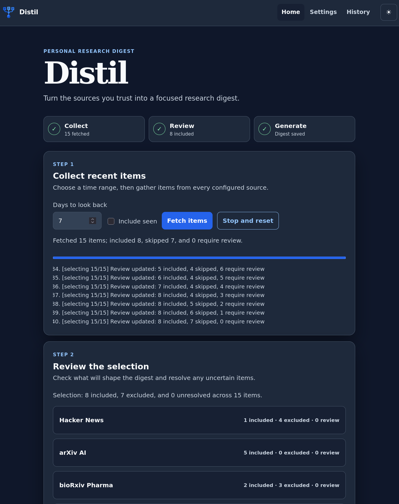
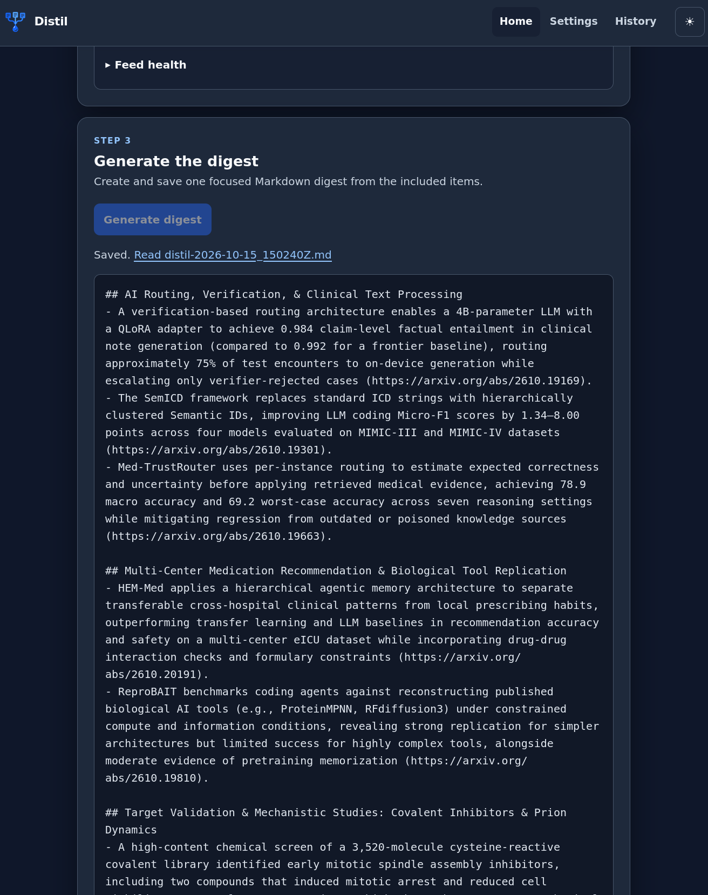
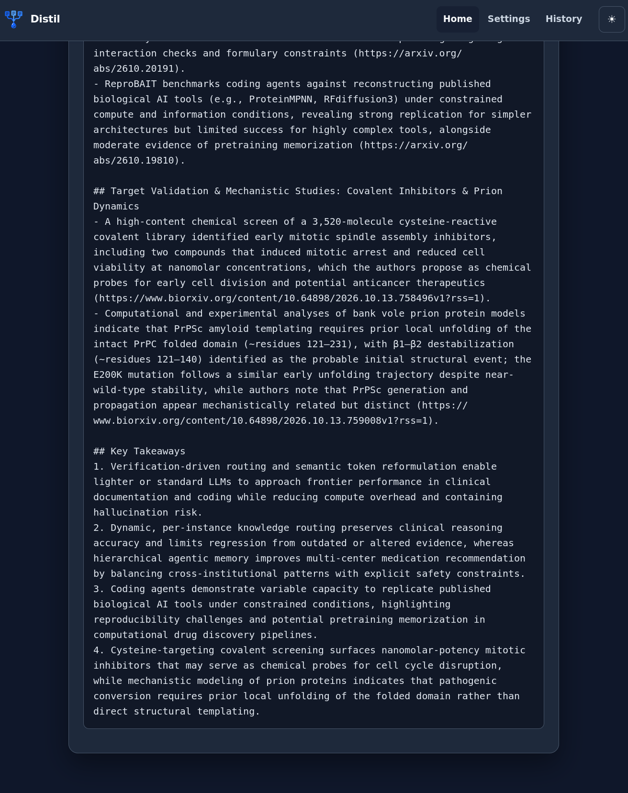

  

<h1 align="center">Distil</h1>

Distil collects recent RSS, Atom, and YouTube content, filters it for relevance, and
produces a concise Markdown research digest with Ollama or any OpenAI-compatible
chat-completions API, including Mistral and 9Router.

The application is written in TypeScript for Bun. It has no third-party runtime packages:
configuration, feed parsing, CLI handling, web serving, streaming, and tests all use
repository code, Web APIs, or Bun and Node-compatible built-ins.

## See Distil in action

Collect recent items, review every relevance decision, then generate a focused Markdown
digest. Include and Exclude choices remain reversible until generation starts.

  
  

## Requirements

- [Bun 1.4.3 or newer](https://bun.sh/docs/installation)
- [Ollama](https://ollama.com/download) for local models, or an API key for a compatible
  hosted provider
- [Strands Decider](https://github.com/strands-labs/strands-decider) only when optional
  local relevance decisions are enabled
- [yt-dlp](https://github.com/yt-dlp/yt-dlp) only for YouTube sources

## Quick start

With Ollama installed:

    bun run distil setup
    bun run distil run

The setup command verifies configured local services. It starts Ollama and pulls its model
only when `manage_local = true`. To use the local web UI instead:

    bun run distil serve

The UI listens on `http://127.0.0.1:5001`. Fetching runs as an in-process background job:
the page reports source and Strands progress, and leaving for history then returning
resumes the same view. **Stop and reset** cancels an in-flight fetch and clears its cached
result. The UI previews feed health and explained item-selection decisions. Every
low-confidence or failed decision must be explicitly included or excluded before the UI
enables generation. It then streams generation progress and stores collision-safe history
files under `history/`. An indeterminate progress bar remains visible while the model is
working because compatible LLM APIs do not report a reliable completion percentage.

Open **Settings** in the web UI to configure Distil without editing TOML. The guided form
covers the research focus, local or compatible AI provider, trusted sources, output
preferences, and optional Strands screening. Distil validates the complete form, writes
the selected `--config` file atomically, and uses the saved settings immediately. If that
file is missing or invalid, `distil serve` still opens the UI in setup mode so it can be
repaired. Hosted API keys remain outside the file: enter only the environment-variable
name in Settings and set its secret value before starting Distil.

## LLM configuration

All providers share one small OpenAI-compatible transport. Distil sends
`POST /v1/chat/completions`, supports JSON and SSE responses, retries transient failures,
and applies a request timeout.

### Ollama

The checked-in configuration uses Ollama:

    [llm]
    provider = "ollama"
    model = "qwen3.6:27b"
    base_url = "http://127.0.0.1:11434/v1"
    manage_local = true
    timeout_seconds = 900
    retries = 2

Legacy model values such as `ollama/qwen3.6:27b` remain supported.

For Ollama running on another machine through an SSH tunnel, prevent Distil from invoking
the local `ollama` executable:

    ssh -NT -L 11434:127.0.0.1:11434 USER@OLLAMA_SERVER

    [llm]
    provider = "ollama"
    model = "qwen3.6:27b"
    base_url = "http://127.0.0.1:11434/v1"
    manage_local = false

Unmanaged endpoints are still checked for reachability and model availability. Pull a
missing model on the server rather than on the Distil machine.

### Mistral

Mistral exposes the same chat-completions request shape. Set the key in the environment
rather than in TOML:

    export MISTRAL_API_KEY="..."

Then configure:

    [llm]
    provider = "openai"
    model = "mistral-small-latest"
    base_url = "https://api.mistral.ai/v1"
    api_key_env = "MISTRAL_API_KEY"
    timeout_seconds = 120
    retries = 2

### Other OpenAI-compatible services

Set `provider = "openai"`, choose the service's model and base URL, and name the
environment variable that holds its key:

    [llm]
    provider = "openai"
    model = "your-model"
    base_url = "https://provider.example/v1"
    api_key_env = "PROVIDER_API_KEY"

For a local endpoint with no authentication, set `api_key_env = ""`.

[9Router](https://github.com/decolua/9router) is useful when routing or provider failover
is needed:

    base_url = "http://127.0.0.1:20128/v1"
    api_key_env = "NINEROUTER_KEY"

[Headroom](https://github.com/headroomlabs-ai/headroom) can be placed in front of a
compatible provider when prompt compression is worth the extra local service. Point
`base_url` at its OpenAI-compatible proxy. Distil does not require either service and does
not embed OpenHands or Diffy in its runtime.

## Local relevance decisions

Distil can ask Strands Decider whether each new item is useful for the configured research
focus before calling the generative model. Strands has a custom classification head, so it
does not run through Ollama. Run its official local server separately:

    pip install strands-decider
    strands-decider serve StrandsAgents/strands-decider-2B-hobson-v21 --port 8000

Then enable its loopback endpoint:

    [decision]
    enabled = true
    base_url = "http://127.0.0.1:8000"
    confidence_threshold = 0.85
    timeout_seconds = 10

The default threshold of `0.85` accepts common high-confidence decisions while leaving
less certain items for review. Raise it toward `1` for stricter manual oversight or lower
it cautiously to automate more decisions. Existing explicit configuration values are not
changed automatically.

Distil accepts a Strands include or exclude classification only when it meets the
configured confidence threshold. The preview labels those results **Include** or
**Exclude**, previously processed items **Seen**, and lower-confidence results **Review**.
A malformed response, timeout, or unavailable service is labelled **Fallback**. Review and
Fallback items remain unresolved and never enter a digest until the user explicitly
includes or excludes them. There is no second, lower acceptance threshold: every result
below `confidence_threshold` requires review. Decision endpoints are restricted to
loopback, so source material is never sent to a hosted fallback. Strands confidence
measures confidence in its relevance classification; it does not establish the scientific
truth, quality, or reproducibility of a source's claims.

Distil does not install or start Strands. When decision selection is enabled,
`bun run distil setup` verifies that its server is healthy alongside Ollama.

Preview selection without calling the generative LLM:

    bun run distil preview --days 7

The web UI offers Include and Exclude controls beside every unresolved item, plus explicit
bulk controls. Every settled item can be changed from Include to Exclude or back again
until generation starts. CLI `run` stops when review is required; after inspecting
`preview`, opt in to a deterministic bulk decision when appropriate:

    bun run distil run --review-policy=include
    bun run distil run --review-policy=exclude

After a digest is saved, Distil records reviewed item fingerprints in
`.distil/state.json`. Later runs skip them; use `--include-seen` or the web checkbox to
reconsider them. Previewing never marks an item as seen.

CLI `run` and `preview` report progress as each source completes and as Strands evaluates
each new item. Press `Ctrl+C` to stop a CLI process.

## Sources and filtering

Each `[[feeds]]` entry accepts:

| Field       | Meaning                                                                  |
| ----------- | ------------------------------------------------------------------------ |
| `url`       | Required HTTP(S) RSS, Atom, YouTube video, channel, or playlist URL      |
| `name`      | Display name; defaults to the URL hostname                               |
| `type`      | Optional `rss` or `youtube`; YouTube URLs are detected automatically     |
| `max_items` | Maximum matching items or transcripts                                    |
| `keywords`  | Include an item when any keyword occurs in its title or summary          |
| `pattern`   | Additional case-insensitive JavaScript regex; leading `(?i)` is accepted |

YouTube captions are downloaded into the ignored `transcripts/` directory. Source text is
treated as untrusted data in prompts.

## Commands

    bun run distil run --days 3
    bun run distil run --include-seen
    bun run distil run --review-policy=exclude
    bun run distil preview --days 7
    bun run distil run --config custom.toml
    bun run distil serve --host 127.0.0.1 --port 5001 --no-browser
    bun run distil setup
    bun run distil --help

CLI digests use `[output].directory`; web history uses `history/`. Both use timestamped,
collision-safe filenames and never silently replace an existing digest. Prompt batches are
bounded by source-text size rather than a fixed number of items.

To build a bundled, minified, self-contained Bun executable for the current operating
system and architecture:

    bun run compile

The output is `distil-bin` (or `distil-bin.exe` on Windows). Native executables are
target-specific, so a cross-platform release uses one single-file build per supported
Bun `--target`. Each release artifact is smoke-tested on its target platform. The binary
embeds the UI logo and does not load `.env` or `bunfig.toml` automatically.

Tagged releases build and smoke-test Bun archives for Linux x86-64, macOS ARM64, and
Windows x86-64. Create a tag matching the version in `package.json`, such as `v0.4.0`; the
release workflow verifies the tag, generates SHA-256 checksums and provenance
attestations, and publishes the archives without overwriting an existing release.

## Development

    bun run check

The check task checks formatting, lints, type-checks, and runs the full deterministic test
suite. Formatting and linting require Bun's newer built-in `fmt` and `lint` commands; CI
uses the canary tooling channel while runtime verification and release builds stay on
stable Bun 1.4.3. Run `bun run verify` when only stable Bun is available.

Tests mock network, LLM, and Ollama boundaries; they do not spend API credits or download
models. The web server binds to loopback by default and has no authentication. Do not
expose it publicly without adding an authentication and authorization design.
